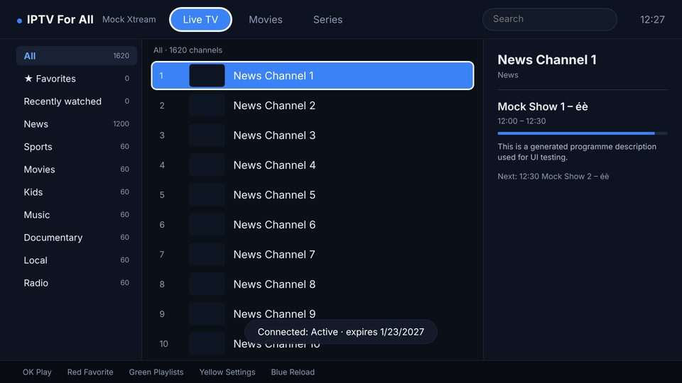
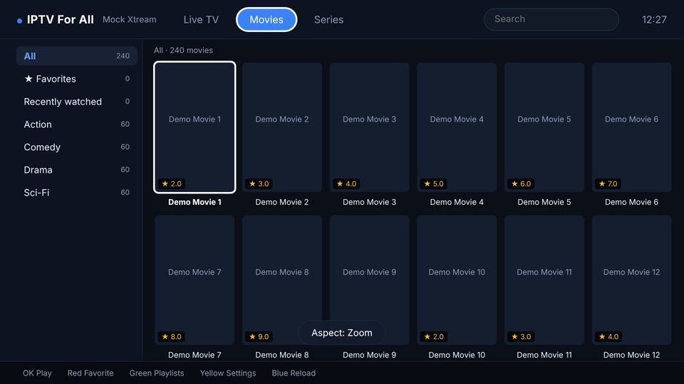
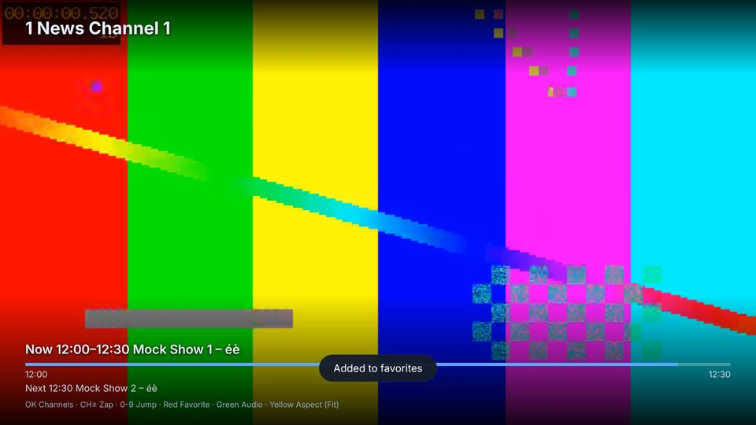

# IPTV For All

An open-source IPTV player for **LG webOS TVs**, in the spirit of IPTV Smarters / Smarter IPTV.
You bring your own playlist or provider login; the app ships with **no channels or content**.

| Live TV | Movies | Player |
|---|---|---|
|  |  |  |

## Features

- **Xtream Codes** logins (verified on save) and **M3U / M3U8** URLs, multiple playlists
- **Live TV, Movies, Series** (seasons and episodes), categories, search, **favorites**, recently watched
- **EPG** now/next for Xtream live channels (list panel and player overlay)
- **Smart cache for movies and episodes** (MP4): reads ahead in small range requests, keeps a rolling cache in memory,
  waits for a head start before playing and refills after an underrun instead of stuttering. See [Smart cache](#smart-cache)
- **Seek anywhere**: click or drag on the progress bar with the Magic Remote (hover shows the time), type a time with the
  number keys (`1 3 0` = 1:30), or jump by 10 s / 1 min / 10 min. The bar shows what is already cached
- **Saved playlists**: the downloaded catalog is kept on the TV (IndexedDB), so the next start is instant and needs no
  request. It refreshes in the background (Settings: every start / 6 h / 1 day / only when you press Blue) and swaps in place
  without losing your spot. If the provider is down or slow, the saved copy is shown instead of an error
- **Continue watching**: the Movies and Series tabs open on your unfinished titles with a progress bar; an episode opens its
  series on that episode. Finished titles drop off the list
- Resume where you left off, auto-play next episode, aspect cycling, audio-track switching, auto-retry on dropped live streams
- Live: CH+/CH- zapping, number-key channel entry, channel drawer (OK)
- HLS through the TV's native player, or **hls.js** (Settings) with a configurable read-ahead for movies
- Magic Remote and D-pad friendly: colour keys, media keys, pointer clicks
- Handles huge playlists (tens of thousands of channels): only the visible rows exist in the DOM
- No build step; vendored libraries: hls.js (Apache-2.0) and mp4box.js (BSD-3-Clause)

### Remote control

| Key | Browse | Live player | Movie / episode player |
|---|---|---|---|
| OK | play / select | channel drawer | pause / play (while caching: start now) |
| Up / Down | move | next / previous channel | **+1 min / -1 min** (episodes: next / previous episode) |
| CH+ / CH- | page | next / previous channel | **+10 min / -10 min** (episodes: next / previous episode) |
| Left / Right | change column | | -10 s / +10 s (grows to 5 min if you keep tapping) |
| 0-9 | | jump to channel number | **type a time to jump to**, e.g. `1 3 0` then OK = 1:30 |
| Red | add / remove favorite | favorite | favorite |
| Green | playlists | audio track | audio track |
| Yellow | settings | aspect (Fit / Zoom / Stretch) | aspect |
| Blue | reload playlist | info | **Go to time** box |
| Back | up one screen (exits from the playlist list) | stop | stop (closes the Go-to-time box first) |
| Magic Remote pointer | click to select | click = channel drawer | **click / drag the bar to jump**, click the picture = pause |

## Smart cache

Many TV media pipelines buffer only a few seconds of a progressive file, so on a slow or unsteady connection a movie
stutters and "loading" appears again and again. For **MP4 movies/episodes** (`.mp4`, `.m4v`, `.mov`) the app plays through
Media Source Extensions with its own cache instead of leaving it to the TV:

- fetches the file in adaptive **HTTP range requests** (small on slow links) and remuxes them on the fly with mp4box.js
- keeps a rolling window in memory: read-ahead (to the budget you pick: 64 / 128 / 256 MB) plus a back buffer so rewinding is instant
- **waits for an 8 s head start**, and if the link falls behind the video it **pauses once and refills** (to ~12-30 s) instead of
  stuttering, with a "Caching 12 / 20 s · 450 KB/s" message. Pressing OK skips the wait
- pausing a movie keeps filling the cache, so you can pause for a few minutes on a slow link and then watch uninterrupted
- a seek outside the cache jumps straight to the right byte offset (no downloading from the start); moov-at-the-end files work
- anything unexpected (codec not playable through MSE, no range support, network errors, nothing playing after 20 s)
  silently falls back to normal playback at the current position, with a toast saying why

Limits you should know about:

- **MKV, AVI, TS and other containers use the TV's own player** (no cache control). Many Xtream providers serve movies as `.mkv`;
  the app cannot remux Matroska in JavaScript on TV hardware. If your provider offers `.mp4` for a title, that one gets the cache.
- It cannot make a connection faster than the video bitrate: below that rate you will wait, but once, up front or after an
  underrun, instead of constantly.
- The cache lives in memory only (nothing is written to disk) and is dropped when you leave the movie.
- It first reads the file with plain range requests from the TV; some providers throttle or ban range-heavy clients.
  Turn the cache off in **Settings > Smart cache** if a provider misbehaves.
- HLS movies use hls.js buffering instead (**Settings > HLS movie buffer**), which only applies when the hls.js engine is in use.

## Install on your TV

You need an LG TV on **webOS 4.0 or newer (2018+)**. Sideloading uses LG's Developer Mode.

1. On the TV: install **Developer Mode** from the LG Content Store, sign in with a free LG developer account, switch Dev Mode and *Key Server* on, and note the TV's IP address.
2. On your computer (Node 18+):
   ```sh
   npm install
   npx ares-setup-device            # add the TV: host = TV IP, port 9922, user = prestodev; name it "tv"
   npx ares-novacom --device tv --getkey   # enter the passphrase shown in the Developer Mode app
   npm run package                  # -> dist/com.iptvforall.app_0.1.0_all.ipk
   npm run install:tv
   npm run launch:tv
   ```
3. Dev Mode sessions expire after a while; re-open the Developer Mode app and extend the session when the app stops launching.

CI builds the `.ipk` on every push (see the **ipk** artifact of the workflow run).

## Adding a playlist

Typing on a TV is slow, so the form takes the minimum: for **M3U**, a URL; for **Xtream**, server URL, username, password.

If the TV cannot reach your provider's API because of CORS rules, set a **CORS proxy** prefix in Settings
(the real URL is appended URL-encoded). Streams played by the TV's own pipeline do not need CORS. The smart cache and hls.js
read streams with XHR, so a server that blocks cross-origin requests makes them fall back to native playback.

## Develop on a desktop

```sh
npm install
npm run mock:media     # one-time, needs ffmpeg: generates test patterns (no real content)
npm run dev            # http://localhost:8080  (Xtream demo/demo at http://localhost:8080, M3U at /playlist.m3u)
```

Open it in a browser. The 1920x1080 stage scales to the window; arrow keys = D-pad, Enter = OK, Esc = Back, F1-F4 = Red/Green/Yellow/Blue, PageUp/PageDown = CH+/CH-.
The mock server has test hooks: `/__throttle?kbps=80` (slow media, `0` = off), `/__delay?ms=2500` (slow API), `/__fail?on=1` (provider down),
`/__rename?suffix=%20v2` (change channel names), `/__stats` (request counts).

```sh
npm test                    # unit tests: M3U parser, Xtream client, cache policy, time entry
npm run check:syntax        # app code and vendored libs must stay ES2015 (webOS 4 ships Chromium 53)
npm run test:e2e            # keyboard/pointer-driven UI run + smart-cache and saved-playlist scenarios (needs playwright + Chromium and mock:media)
SLOW=1 node tests/e2e/cache.mjs   # additionally proves the pause-and-refill behaviour on a link slower than the video (~2 min)
```

### Layout

```
app/                 the webOS app (this folder is what ares-package ships)
  appinfo.json
  js/m3u.js          M3U parser (also runs in Node for tests)
  js/xtream.js       Xtream Codes API client (also runs in Node)
  js/cache-player.js smart cache: MP4 over MediaSource, read-ahead, eviction, refill policy (policy is unit-tested)
  js/library-cache.js saved playlists (IndexedDB) + refresh policy
  js/continue.js     "Continue watching" list building (unit-tested)
  js/timeentry.js    "type a time" entry
  js/engine.js       <video> + hls.js + smart cache wrapper, retries, stall watchdog
  js/widgets.js      VirtualGrid (windowed list/grid), ListZone (buttons/inputs/selects)
  js/screens/*.js    playlists, form, settings, main browser, series, player
tools/mock-server.mjs   fake Xtream + M3U provider, range-capable media server with throttling
tests/                  unit + e2e
```

## Status

- Developed and tested in desktop Chromium against the mock server: unit tests, a keyboard/pointer-driven end-to-end run,
  cache scenarios (eviction, far seeks, seeks after EOF, moov-at-the-end files, slow links, a real underrun) and a successful `ares-package`.
- **It has not been run on a physical LG TV yet.** In particular the smart cache depends on the TV's MSE implementation
  (codec support, memory limits) and on your provider's range-request support. It falls back to native playback on errors,
  but a silent misbehaviour on some model is possible: if so, switch **Settings > Smart cache** to *Off* and please report the model and webOS version.

## Not implemented yet

XMLTV EPG for plain M3U playlists and a channel guide grid, subtitles, catch-up/timeshift, parental lock/PIN, movie detail pages
(plot, cast, trailer), entering playlists from a phone, MKV caching, multi-view/PiP, Stalker portals, UI translations/RTL.

Plain-M3U movies/series are detected only from Xtream-style URLs (`/movie/`, `/series/`) or video file extensions; everything else is Live.
Browsers cannot send custom HTTP headers for media, so `|User-Agent=...` suffixes in M3U URLs are ignored.
You are responsible for only using playlists and services you are entitled to.

## Related open-source projects

None of the projects below is packaged for webOS as far as I could find, which is why this one exists:
[IPTVnator](https://github.com/4gray/iptvnator) (MIT; Angular, M3U/Xtream/Stalker, XMLTV EPG, hls.js/Video.js; desktop, PWA and Docker),
[Open TV](https://www.justgeek.fr/open-tv-application-iptv-open-source-138264/) (M3U/Xtream; desktop and mobile),
[Another IPTV Player](https://www.linuxlinks.com/another-iptv-player/) (Flutter; M3U/Xtream),
[Ultra TV](https://awesome.ecosyste.ms/projects/github.com%2Fkhalilbenaz%2Fultra-tv) (MIT; web, desktop and Android TV).
Libraries used: [hls.js](https://github.com/video-dev/hls.js), [mp4box.js](https://github.com/gpac/mp4box.js).

## License

Apache-2.0, see [LICENSE](LICENSE). Vendored: `app/js/vendor/hls.min.js` ([hls.js](https://github.com/video-dev/hls.js), Apache-2.0,
`hls.js.LICENSE`) and `app/js/vendor/mp4box.all.min.js` ([mp4box.js](https://github.com/gpac/mp4box.js), BSD-3-Clause, `mp4box.js.LICENSE`).
